# shaktIQ ⚡ — Autonomous API Release Intelligence & Breaking Change Governance Platform

<p align="center">
  
</p>

<p align="center">
  <strong>Deterministic OpenAPI Breaking Change Detection, Multi-Model AI Remediation & Enterprise Release Compatibility Gates</strong>
</p>

<p align="center">
  <a href="https://marketplace.visualstudio.com/items?itemName=shaktIQ.shaktiq-vscode"></a>
  <a href="https://shaktiq.vercel.app"></a>
  <a href="https://uncharted-shakti-1.onrender.com/api/v1/health"></a>
  <a href="https://www.mongodb.com/atlas"></a>
  <a href="https://nodejs.org/"></a>
  <a href="https://nextjs.org/"></a>
  <a href="https://fastify.dev/"></a>
  <a href="https://n8n.io/"></a>
  <a href="LICENSE"></a>
</p>

shaktIQ is an enterprise-grade API release intelligence platform and autonomous compatibility gate built for modern software teams, API platform architects, and microservice ecosystems. Powered by a deterministic Abstract Syntax Tree (AST) diffing engine, multi-model Google Gemini AI remediation, and historical MongoDB Atlas memory, shaktIQ safeguards downstream consumers—including mobile applications (iOS/Android), web frontends, and external API partners—against contract drift, breaking schema alterations, and unannounced parameter changes before code ever hits production.

> [!IMPORTANT]
> **Platform Scope & Primary Deliverables:**  
> shaktIQ is **not** a mobile or Android application. shaktIQ is a developer platform composed of three core developer deliverables:
> 1. **🌐 Web Application & Intelligence Studio (`apps/web`):** Full-stack Next.js 15 platform with an interactive API comparison studio, real-time Server-Sent Events (SSE) telemetry, MongoDB Atlas recurring hotspot radar, and AI Release Dossier generator.
> 2. **💻 Visual Studio Code Extension (`apps/vscode-ext`):** Native IDE extension (v0.2.1) providing real-time in-editor AST squiggly diagnostics, universal file and folder auditing (supports Python, TypeScript, JavaScript, Go, Java, and OpenAPI without requiring an `openapi.yaml`), and 1-click backward-compatible AI remediations.
> 3. **🤖 In-Flight AI Coding Agent Skill & MCP Server (`.agents/skills/shaktiq` & `packages/analyzer`):** Standard Model Context Protocol (MCP) server and agent skill for Google Antigravity, Cursor, Windsurf, and Claude Code to verify contracts during automated code refactoring.
> *(Supported by a standalone Terminal CLI and an automated GitHub Actions CI/CD PR blocking gate).*

---

## 📑 Visual Table of Contents

| Section | Visual Type | Focus Area |
| :--- | :--- | :--- |
| **[1. End-to-End System Architecture](#1-end-to-end-system-architecture)** | System Flow Diagram | Developer Gateways, Vercel Edge, Fastify Core, MongoDB Atlas, Gemini AI |
| **[2. The Core Problem & How shaktIQ Differentiates](#2-the-core-problem--how-shaktiq-differentiates)** | Competitive Matrix | shaktIQ vs. Manual PR Review vs. Raw LLM Bots vs. Linters vs. Git Diff |
| **[3. Deterministic AST Analysis & Decision Machine](#3-deterministic-ast-analysis--decision-machine)** | Decision Pipeline | OpenAPI 3.0/3.1 AST parser, oasdiff engine, SHA-256 fingerprints |
| **[4. The 3-Tier Release Safety Verdict Engine](#4-the-3-tier-release-safety-verdict-engine)** | Gate Decision Flowchart | SAFE 🟢, REVIEW 🟡, BLOCKED 🔴 verdict evaluation and CI exit codes |
| **[5. Triple Developer Gateway Architecture](#5-triple-developer-gateway-architecture)** | Multi-Gateway Flowchart | Gateway 1: GitHub PR Gate · Gateway 2: VS Code · Gateway 3: Web Console & Agents |
| **[6. In-Flight AI Coding Agent Skill & MCP Server](#6-in-flight-ai-coding-agent-skill--mcp-server)** | Agent Cycle Flowchart | Antigravity, Cursor, Windsurf, Claude Code contract verification loop |
| **[7. n8n Event-Driven Orchestration Workflow](#7-n8n-event-driven-orchestration-workflow)** | Asynchronous Pipeline | Webhook signature verification, spec fetching, analysis dispatch, PR comments |
| **[8. Speculative Multi-Model Gemini AI Engine](#8-speculative-multi-model-gemini-ai-engine)** | Parallel Race Flow | Dual-model racing (`gemini-3.5-flash-lite` + `gemini-flash-lite-latest`) for sub-2s fixes |
| **[9. Downstream Consumer Blast Radius Matrix](#9-downstream-consumer-blast-radius-matrix)** | Impact Breakdown | Mobile apps (iOS/Android), Web SPAs, Microservices, Partner APIs |
| **[10. Historical Hotspot Intelligence & Memory](#10-historical-hotspot-intelligence--project-memory)** | Aggregation Pipeline | MongoDB Atlas aggregations identifying recurring API fragility across sprints |
| **[11. Production MongoDB Atlas Architecture](#11-production-mongodb-atlas-architecture)** | Storage Architecture | Strict `$jsonSchema`, unique compound indexes, Change Streams + SSE, TTL cleanup |
| **[12. Cryptographic Security & Threat Model](#12-cryptographic-security--threat-model)** | Sequence & Redaction | HMAC-SHA256 signature verification, Argon2id passwords, SHA-256 PATs, AI privacy |
| **[13. Continuous Integration & DevOps Pipeline](#13-continuous-integration--devops-pipeline)** | Build Pipeline Flow | GitHub Actions, TypeScript verification, Vitest test suites, and Playwright E2E |
| **[14. Step-by-Step Operator Guide (5 Ways to Use)](#14-step-by-step-operator-guide-5-ways-to-use)** | Chronological Walkthrough | Web Dashboard, VS Code Extension, Coding Agent Skill, CLI, and CI/CD PR Gates |
| **[15. Local Development & Monorepo Quickstart](#15-local-development--monorepo-quickstart)** | Code Configuration | Step-by-step local bootstrap, Docker, migrations, and environment schema |
| **[16. Team & Ownership](#16-team--ownership)** | Team Credits & Docs | Engineering ownership, architecture specifications, and MIT License |

---

## 1. End-to-End System Architecture

shaktIQ connects developer tooling, version control, deterministic analyzers, and cloud intelligence into a unified, high-availability platform:

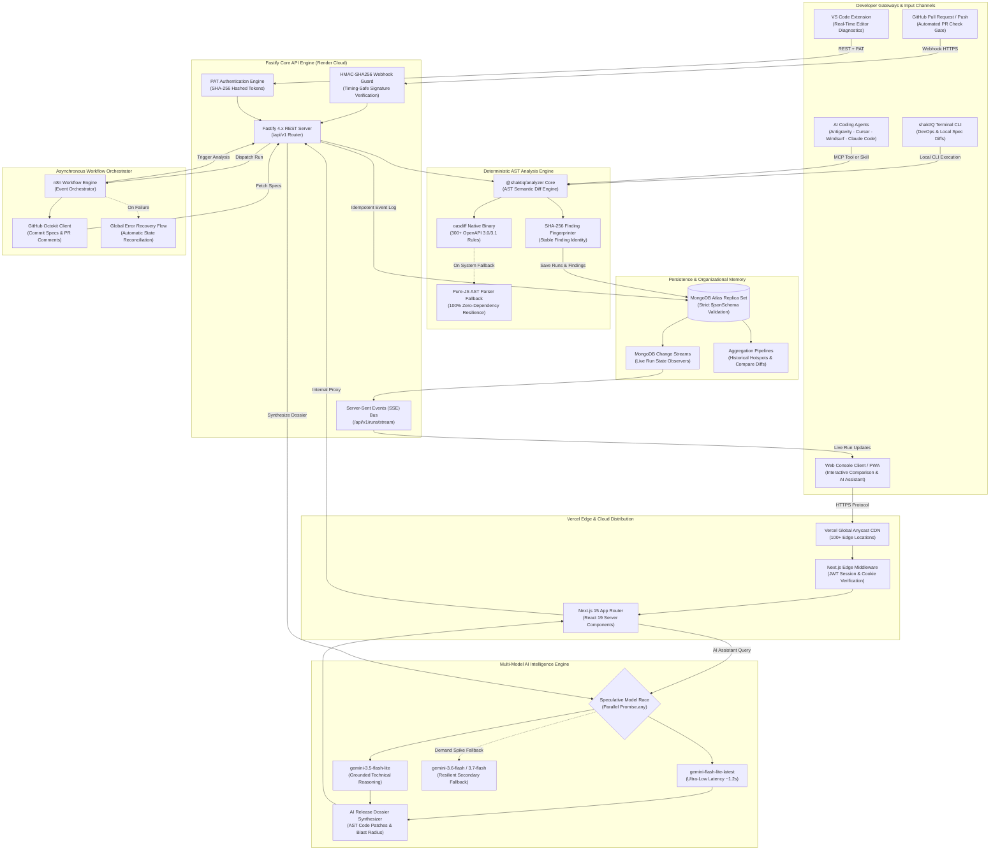

---

## 2. The Core Problem & How shaktIQ Differentiates

### The Industry Challenge
Software engineering organizations build microservices, public APIs, and mobile backends at rapid velocity. However, altering an OpenAPI contract—such as renaming a field, tightening regex validation, changing a response type, or adding a required request parameter—causes catastrophic downstream outages. Mobile apps running older client versions in the wild crash instantly, partner integrations break, and frontend user flows fail silently.

### Feature & Architectural Differentiation Matrix

| Evaluation Dimension | Manual PR Review | Raw LLM Bots (ChatGPT / Claude) | Static Linters (Spectral / Vacuum) | Basic Git Diff | shaktIQ Platform ⚡ |
| :--- | :---: | :---: | :---: | :---: | :---: |
| **Deterministic Rule Evaluation** | ❌ Fatigue-prone | ❌ Hallucination risk | ✅ Deterministic | ❌ Text-only | **✅ 100% Deterministic (300+ Rules)** |
| **CI/CD Hard Blocking Exit Code** | ❌ Manual | ❌ Non-deterministic | ⚠️ Style only | ❌ Unreliable | **✅ Non-Bypassable (Code 1 on BREAKING)** |
| **Version-to-Version Git Diffing** | ⚠️ High effort | ⚠️ Slow / Costly | ❌ Single file only | ⚠️ False positives on whitespace | **✅ Semantic AST Diff (Branch & Head)** |
| **Mobile App Blast Radius Analysis** | ❌ Blind spot | ⚠️ Generic guessing | ❌ None | ❌ None | **✅ Segmented: iOS/Android, Web, Services** |
| **Automated Code Fix Synthesis** | ❌ None | ⚠️ High hallucination | ❌ None | ❌ None | **✅ Context-Grounded AST Patch Shims** |
| **Sub-2s Real-Time AI Generation** | ❌ N/A | ❌ 15–35s latency | ❌ N/A | ❌ N/A | **✅ ~1.2s Speculative Model Race** |
| **Historical Hotspot Memory** | ❌ Team amnesia | ❌ Zero memory | ❌ Stateless | ❌ Stateless | **✅ MongoDB Atlas Recurring Break Tracker** |
| **In-Editor Real-Time Diagnostics** | ❌ None | ❌ Chat only | ⚠️ Style warnings | ❌ None | **✅ Native VS Code Squiggly Diagnostics** |
| **Coding Agent In-Flight Integration** | ❌ None | ❌ None | ❌ None | ❌ None | **✅ Antigravity Skill + MCP Protocol** |

---

## 3. Deterministic AST Analysis & Decision Machine

shaktIQ separates deterministic contract verification from generative AI synthesis. The core AST engine parses specifications, builds structured object representations, and evaluates changes across hundreds of strict compatibility rules.

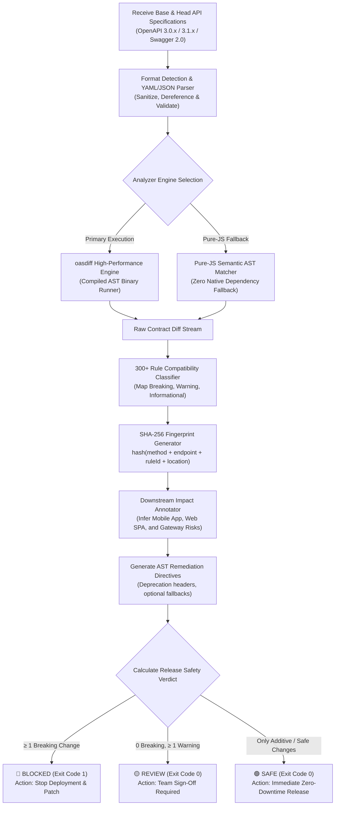

### Breaking Change Rule Spectrum (Sample)

```
┌────────────────────────────────────────────────────────────────────────────────────────┐
│                               CRITICAL BREAKING RULES                                  │
├────────────────────────────────────────────────────────────────────────────────────────┤
│ • api-path-removed-without-deprecation         • response-required-property-removed    │
│ • api-method-removed-without-deprecation       • response-property-type-changed        │
│ • request-parameter-became-required            • request-body-type-changed             │
│ • request-parameter-type-changed               • response-status-code-removed          │
│ • request-parameter-enum-value-removed         • response-success-status-changed       │
└────────────────────────────────────────────────────────────────────────────────────────┘
```

---

## 4. The 3-Tier Release Safety Verdict Engine

Every run produces an unambiguous verdict calculated from deterministic rule outcomes:

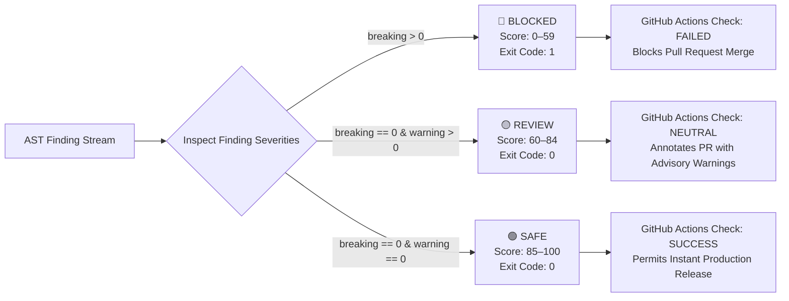

### Detailed Verdict Policy Breakdown

| Verdict | Indicator | Score Band | CI Exit Code | Production Implication | Action Required |
| :--- | :---: | :---: | :---: | :--- | :--- |
| **`SAFE`** | 🟢 | **85 – 100** | `0` | Strictly non-breaking (additive endpoints, optional query params, new response fields). | Merge and deploy immediately with zero downtime. |
| **`REVIEW`** | 🟡 | **60 – 84** | `0` | Deprecations, altered property descriptions, or structural warnings present. | Engineering team review advised before releasing to production. |
| **`BLOCKED`** | 🔴 | **0 – 59** | `1` | One or more critical breaking contract modifications detected. | **Hard CI block.** Apply backward-compatible patch shims. |

---

## 5. Triple Developer Gateway Architecture

shaktIQ meets engineers wherever they write and deploy code through three dedicated gateways:

```mermaid
flowchart TD
    CodeModification["Developer Modifies OpenAPI Spec / Controller Code"] --> GatewayBranch{"Select Working Gateway"}
    
    subgraph Gateway1 ["Gateway 1: GitHub Pre-Release Gate"]
        G1_Push["git push / Pull Request Opened"] --> G1_Hook["GitHub Webhook Received"]
        G1_Hook --> G1_Verify["HMAC-SHA256 Signature Verified"]
        G1_Verify --> G1_Diff["Automated Branch-to-Main Spec Diff"]
        G1_Diff --> G1_Verdict["Calculate Release Verdict"]
        G1_Verdict --> G1_Comment["Post Detailed PR Comment Dossier"]
        G1_Verdict --> G1_Status["Set Commit Status (Pass / Fail)"]
    end
    
    subgraph Gateway2 ["Gateway 2: Visual Studio Code Extension"]
        G2_Type["Developer Edits openapi.yaml in VS Code"] --> G2_Command["Run 'shaktIQ: Analyze API changes'"]
        G2_Command --> G2_LocalDiff["Local Working File vs. git HEAD Diff"]
        G2_LocalDiff --> G2_Diag["Red Squiggly Inline Code Diagnostics"]
        G2_Diag --> G2_Problems["Grouped Checklist in Problems Panel"]
        G2_Problems --> G2_Hover["Hover Explanations & Blast Radius Hints"]
    end
    
    subgraph Gateway3 ["Gateway 3: Web Console & Coding Agent Skill"]
        G3_User["User / Agent Accesses shaktIQ"] --> G3_Choice{"Choose Channel"}
        G3_Choice -->|Web Dashboard| G3_Web["Interactive Web Console (shaktiq.vercel.app)<br/>Visual Diffs · Hotspot Charts · SSE Streams"]
        G3_Choice -->|Coding Agent| G3_Agent["AI Coding Agent Skill (Antigravity · MCP)<br/>Runs in-flight contract verification between edits"]
    end

    GatewayBranch --> Gateway1
    GatewayBranch --> Gateway2
    GatewayBranch --> Gateway3
```

---

## 6. In-Flight AI Coding Agent Skill & MCP Server

When AI coding agents (such as Google Antigravity, Cursor, Windsurf, or Claude Code) refactor backend routes and controllers, they often inadvertently alter API contracts. The **shaktIQ Agent Skill & MCP Server** closes this loop by providing autonomous contract auditing tools directly to the agent.

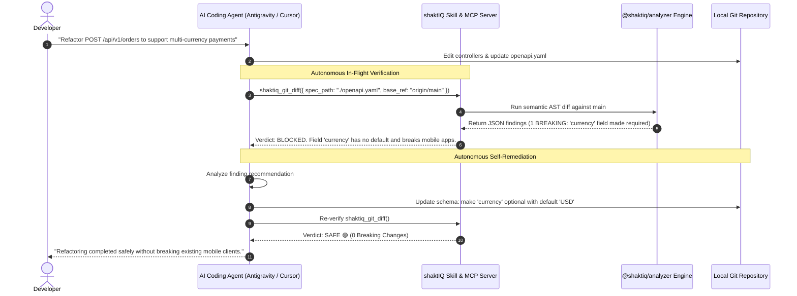

---

## 7. n8n Event-Driven Orchestration Workflow

shaktIQ integrates **n8n** as an asynchronous workflow orchestrator between the Fastify backend, GitHub REST APIs, and downstream alert webhooks. Workflows are version-controlled in [`n8n/workflows/`](n8n/workflows/).

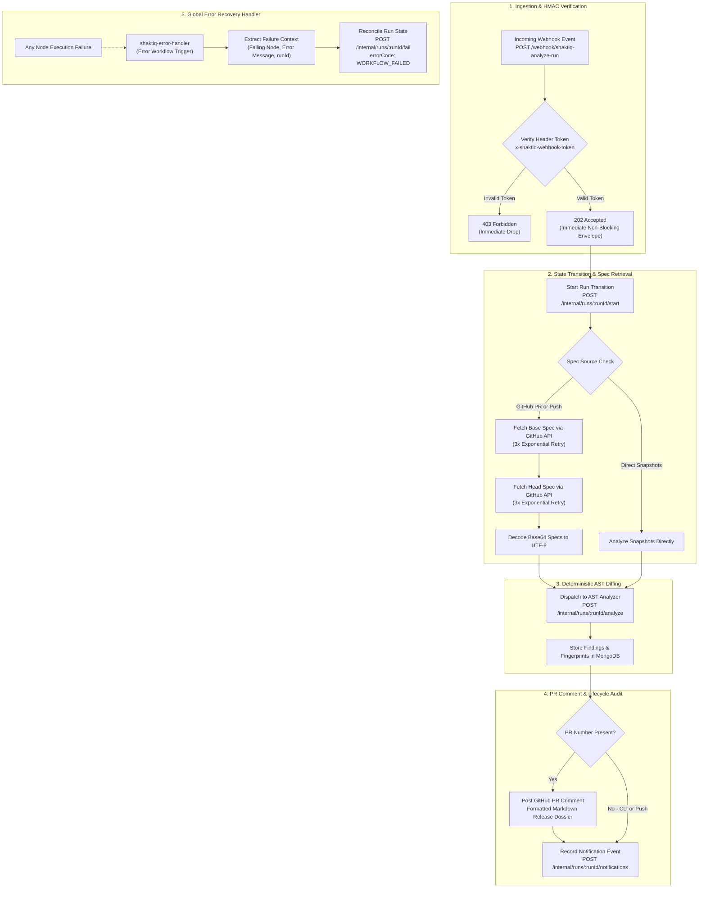

---

## 8. Speculative Multi-Model Gemini AI Engine

To synthesize human-grade **AI Release Dossiers** and actionable code fixes without slowing down developers, shaktIQ uses a **speculative parallel model racing pattern**.

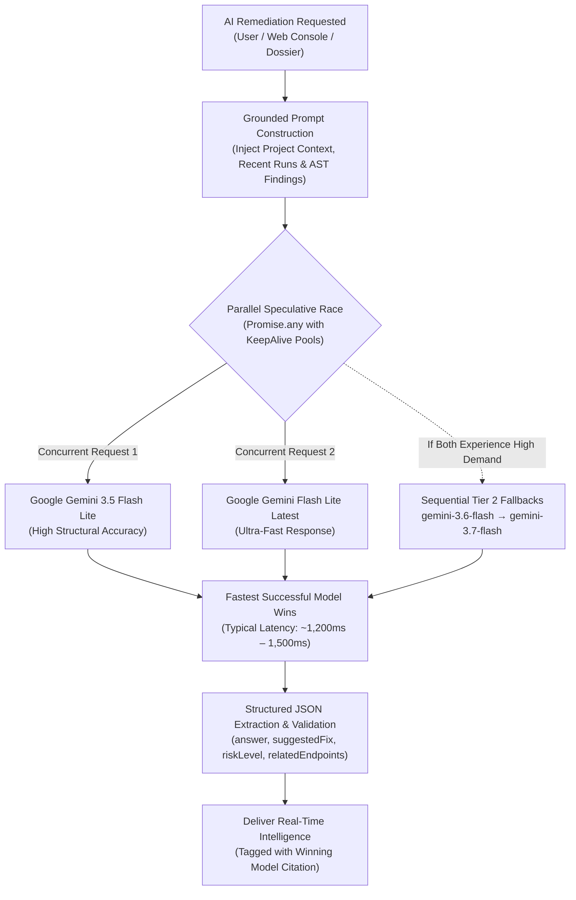

---

## 9. Downstream Consumer Blast Radius Matrix

When a backend engineer introduces an API breaking change, external client applications that consume that API suffer severe outages. In particular, client mobile apps already in end-users' hands cannot update instantaneously. shaktIQ maps findings to specific downstream consumer categories to prevent these outages:

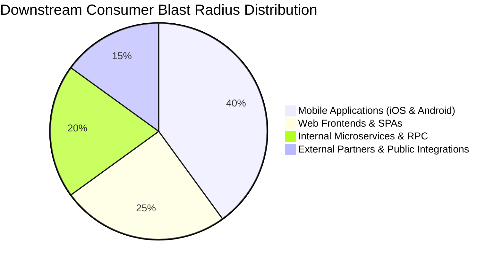

### Impact Breakdown by Consumer Category

| Consumer Tier | Vulnerability Characteristics | Typical Failure Symptoms | shaktIQ Protective Mechanism |
| :--- | :--- | :--- | :--- |
| **Mobile Apps (`iOS / Android`)** | **Cannot update in real-time.** Older client versions remain installed on user devices for months. | JSON parsing null-pointer crashes, screen freeze on launch, `400 Bad Request`. | Detects deleted fields and enforces server-side non-breaking defaults. |
| **Web Frontends (`SPAs`)** | Cached bundles in user browser tabs may send old payload schemas before page refresh. | Checkout form validation errors, unhandled promise rejections, broken routing. | Suggests dual-read middleware supporting old and new parameter keys. |
| **Backend Microservices** | Automated service-to-service RPC calls with strict deserialization models. | Broken event ingestion, queue dead-lettering, downstream cascading 500s. | Verifies response status code continuity and header consistency. |
| **Partner & Public APIs** | External third-party developers relying on published contract promises. | Partner integration outages, SLA breach penalties, emergency hotfixes. | Mandates HTTP `Deprecation` and `Sunset` headers before endpoint removal. |

---

## 10. Historical Hotspot Intelligence & Project Memory

Unlike stateless linters, shaktIQ leverages **MongoDB Atlas Aggregation Pipelines** to build continuous project memory, surfacing endpoints that break repeatedly across releases.

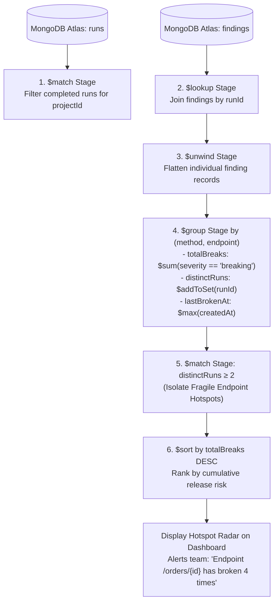

---

## 11. Production MongoDB Atlas Architecture

shaktIQ implements an enterprise-ready MongoDB Atlas architecture:

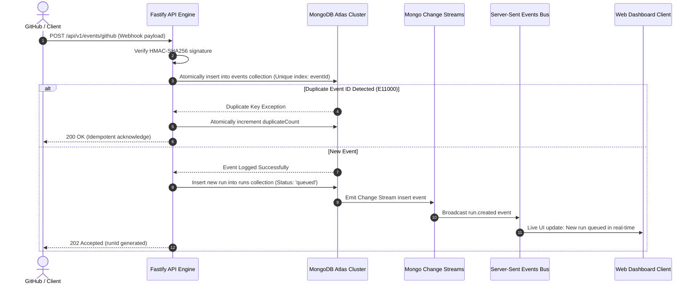

### Database Design & Integrity Controls

1. **Strict `$jsonSchema` Validation:** Enforced on collections (`users`, `apiTokens`, `projects`, `events`, `runs`, `findings`, `specSnapshots`, `notifications`) with `validationLevel: "strict"` and `validationAction: "error"`.
2. **Idempotency & Race-Condition Defense:**
   - `events.eventId`: Unique compound index (`github:<delivery_uuid>`) preventing duplicate webhooks.
   - `findings`: Unique compound index on `{ runId: 1, fingerprint: 1 }` ensuring retry safety.
3. **Automated Data Lifecycle (TTL Indexes):**
   - `events.receivedAt`: 30-day TTL automatically purges raw event logs.
   - `notifications.createdAt`: 90-day TTL index cleans historical delivery records.
4. **Spec De-duplication:** `specSnapshots` collection stores specs de-duplicated by `(projectId, sha256)` hash.

---

## 12. Cryptographic Security & Threat Model

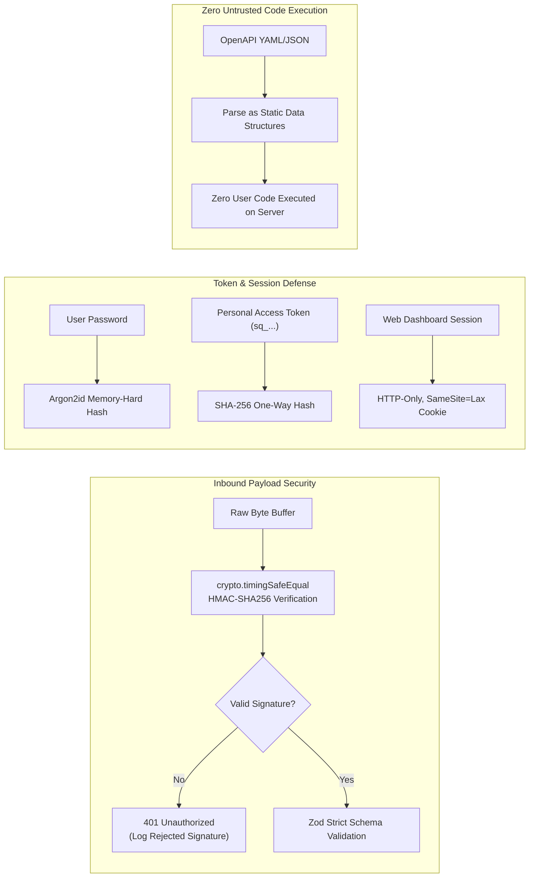

- **Zero Untrusted Execution:** OpenAPI documents are parsed purely as static JSON/YAML data structures; user repository code is never evaluated or executed.
- **HMAC-SHA256 Ingestion:** GitHub webhooks are verified with raw byte buffering and `crypto.timingSafeEqual` against timing attacks.
- **Argon2id Password Security:** Passwords hashed with state-of-the-art Argon2id algorithm.
- **PAT Hashing:** Personal Access Tokens (`sq_...`) are hashed using SHA-256 before storage; raw tokens are shown only once at creation.
- **Redacted AI Prompts:** Gemini queries receive strictly structured finding metadata (method, endpoint, changeType). Proprietary application business logic is never sent to external LLMs.

---

## 13. Continuous Integration & DevOps Pipeline

Every commit and pull request to `main` undergoes an automated multi-stage verification pipeline:

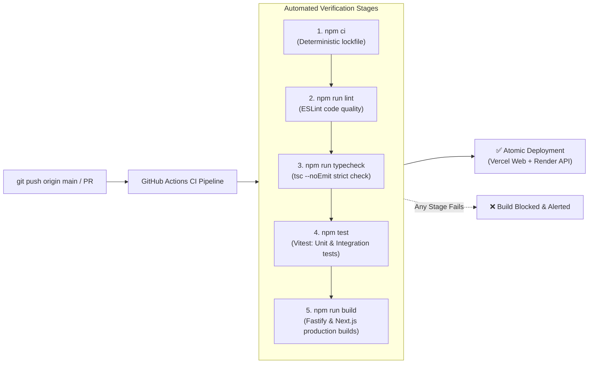

---

## 14. Step-by-Step Operator Guide (5 Ways to Use)

Choose the environment where you work. You can be up and running in **under 2 minutes**:

```
                       ┌──────────────────────────────────────┐
                       │             shaktIQ Hub              │
                       └──────────────────┬───────────────────┘
                                          │
         ┌───────────────┬────────────────┼───────────────┬───────────────┐
         ▼               ▼                ▼               ▼               ▼
   🌐 Web Console   💻 VS Code Ext   🤖 Antigravity  🖥️ Terminal/CLI  🚀 GitHub Actions
  (Instant Trial)  (In-Editor Lint) (AI Agent Skill) (DevOps/Scripts)  (PR Block Gate)
```

---

### Gateway 1: Web Dashboard (Zero Install)

The fastest way to experience shaktIQ without installing any software:

1. Open the live console at **[https://shaktiq.vercel.app](https://shaktiq.vercel.app)**.
2. Sign in with Google OAuth or register an account in 10 seconds.
3. Select an existing project or run an interactive spec comparison between two OpenAPI versions.
4. Inspect the **Blast Radius Matrix** across Mobile (iOS/Android), Web SPAs, and Backend Microservices.
5. Click **AI Release Dossier** to interact with the **shaktIQ Real-Time Intelligence Engine** for instant non-breaking patch code!

---

### Gateway 2: Visual Studio Code Extension (v0.2.0)

Catch breaking API changes, contract flaws, and runtime bugs in real-time as you write code, right inside your editor:

1. **Install in 1 Click:**
   - From the repository root, install the packaged extension:
     ```bash
     code --install-extension shaktiq.vsix --force
     ```
   - Or install from the [VS Code Marketplace](https://marketplace.visualstudio.com/items?itemName=shaktIQ.shaktiq-vscode).
2. **Multi-Language Code & API Auto-Routing:**
   - Open any backend code file (`database.py`, `routers/*.py`, `server.ts`, `routes.js`, etc.) or OpenAPI spec (`openapi.yaml`).
   - Click the **shaktIQ icon $(zap)$** in the editor top title bar, or press `Cmd+Shift+P` (macOS) / `Ctrl+Shift+P` (Windows) ➔ run **`shaktIQ: AI Review Active Code & Contract`** or **`shaktIQ: Analyze API changes & Review Code`**.
3. **Editor Diagnostics & Error Detection:**
   - ShaktIQ performs an AST and contract sweep across your file.
   - Contract breaking risks, unhandled exceptions, and missing default parameter fallbacks are flagged with red and yellow squiggly lines on the exact line.
4. **1-Click AI Quick Fix (Lightbulb 💡):**
   - Click the lightbulb or press `Cmd + .` (or `Ctrl + .`) on any flagged code line.
   - Select **⚡ "shaktIQ: Apply backward-compatible code fix"** to automatically apply the fix!
   - Or select **📖 "shaktIQ: Explain client compatibility impact"** for a full impact breakdown.
5. **Sidebar Intelligence:**
   - Open the **shaktIQ** activity bar icon on the left to see:
     * **Breaking Changes & Issues**: Detailed tree of findings with severity levels.
     * **Detected API Endpoints**: Auto-parsed Python FastAPI/Flask, Node.js, and OpenAPI routes with 1-click jump to code line.
     * **AI Remediation & Fixes**: Contract risk verdict, suggestions, and 1-click **⚡ Apply AI Suggested Fix** button.
6. **Zero-Crash Local Fallback Engine:**
   - Even without an `openapi.yaml` file, and even if offline or on network disconnect, the extension seamlessly falls back to its local heuristic engine and never crashes.

---

### Gateway 3: Coding Agent Gateway & AI Skill (`/shaktiq`)

Equip your AI coding agent (Google Antigravity, Cursor, Windsurf, Claude Code) with the `shaktIQ` skill so it automatically audits code contracts, detects breaking changes, and generates safe fixes **in-between code writing steps (similar to `graphify` for knowledge graphs, `shaktiq` provides the contract safety gateway)**:

#### 1-Step Fast Install:
Run the provided installer script from your project root:
```bash
./scripts/install-agent-skill.sh
```
This script automatically:
1. Compiles `@shaktiq/analyzer`.
2. Symlinks the global CLI binary `shaktiq` and MCP server `shaktiq-mcp` to `~/.local/bin/`.
3. Installs the workspace agent skill at `.agents/skills/shaktiq/SKILL.md`.
4. Installs the global Antigravity skill at `~/.gemini/config/skills/shaktiq/SKILL.md`.

#### Manual Skill Installation:
- **macOS / Linux:**
  ```bash
  mkdir -p ~/.gemini/config/skills/shaktiq .agents/skills/shaktiq
  cp skills/shaktiq/SKILL.md ~/.gemini/config/skills/shaktiq/SKILL.md
  cp skills/shaktiq/SKILL.md .agents/skills/shaktiq/SKILL.md
  ```
- **Windows PowerShell:**
  ```powershell
  New-Item -ItemType Directory -Force "$env:USERPROFILE\.gemini\config\skills\shaktiq"
  Copy-Item "skills\shaktiq\SKILL.md" "$env:USERPROFILE\.gemini\config\skills\shaktiq\SKILL.md"
  ```

#### How Coding Agents Use `shaktiq`:
Prompt your agent in chat:
> *"Audit `apps/api/src/server.ts` or `backend/database.py` with shaktIQ before committing."*
> *"Run `shaktiq fix <file> --apply` to automatically remediate any contract breaking changes."*

---

### Gateway 4: Model Context Protocol (MCP) Server

Connect `shaktIQ` to **Cursor**, **Windsurf**, or **Claude Code** as a standard **Model Context Protocol (MCP)** tool server:

Add the following to your agent configuration (`mcp_config.json` or Cursor Settings ➔ Features ➔ MCP):

```json
{
  "mcpServers": {
    "shaktiq": {
      "command": "node",
      "args": ["packages/analyzer/dist/mcp.js"]
    }
  }
}
```

Exposed native tools:
- `shaktiq_review_code({ file_path, language, project_name })`: Audits code files (`.py`, `.ts`, `.js`, etc.) for breaking contract flaws and returns risk ratings and remediation steps.
- `shaktiq_fix_code({ file_path, code, issues, apply })`: Generates unified diffs and backward-compatible remediations, with optional direct file rewriting.
- `shaktiq_scan_routes({ target_path })`: Automatically extracts all API endpoints across Python FastAPI/Flask, Node.js Express/Fastify/Next.js, and OpenAPI files.
- `shaktiq_analyze({ base_spec, head_spec })`: Analyzes two OpenAPI files directly.
- `shaktiq_git_diff({ spec_path, base_ref })`: Compares your working spec against git `HEAD` or any branch.

---

### Gateway 5: Terminal CLI & CI/CD GitHub Actions Gate

Run deterministic OpenAPI checks and intelligent code audits directly from your terminal:

```bash
# 1. Review any backend code file (.py, .ts, .js) for breaking API flaws:
shaktiq review apps/api/src/server.ts
shaktiq review backend/database.py --markdown

# 2. Automatically generate and apply AI backward-compatible code remediation:
shaktiq fix apps/api/src/server.ts --apply

# 3. Scan and list all API routes in a file or directory:
shaktiq routes apps/api/src/modules/studio/routes.ts
shaktiq routes backend/routers/

# 4. Compare your current working spec against git main branch:
shaktiq git-diff --spec ./openapi.yaml --base-ref main --markdown

# 5. Compare two OpenAPI specification files directly:
shaktiq analyze --base fixtures/openapi/v1-base.yaml --head fixtures/openapi/v2-breaking.yaml --markdown

# 3. Output machine-readable JSON (ideal for custom scripts and agents):
npm run shaktiq -- analyze --base ./base.yaml --head ./head.yaml --json

# 4. Strict CI gate (exits with code 1 if any breaking change is detected):
npm run shaktiq -- analyze --base ./base.yaml --head ./head.yaml --fail-on-breaking
```

#### Automated Pull Request Gate (`.github/workflows/shaktiq.yml`):

```yaml
name: shaktIQ API Release Gate

on:
  pull_request:
    paths:
      - '**/openapi.yaml'
      - '**/openapi.json'
      - '**/swagger.json'

jobs:
  verify-api-compatibility:
    name: Verify Backward Compatibility
    runs-on: ubuntu-latest
    steps:
      - name: Checkout Code
        uses: actions/checkout@v4
        with:
          fetch-depth: 0

      - name: Setup Node.js 20
        uses: actions/setup-node@v4
        with:
          node-version: 20
          cache: 'npm'

      - name: Install Dependencies
        run: npm ci

      - name: Run shaktIQ Compatibility Check
        run: |
          node packages/analyzer/dist/cli.js git-diff \
            --spec ./openapi.yaml \
            --base-ref origin/main \
            --fail-on-breaking \
            --markdown >> $GITHUB_STEP_SUMMARY
```

If a pull request deletes an endpoint or changes a parameter type, the CI workflow exits with code `1`, blocking the merge and printing a clear markdown table directly into the GitHub Actions Step Summary!

---

## 15. Local Development & Monorepo Quickstart

### Monorepo Structure

```
shaktiq/
├── apps/
│   ├── api/            # Fastify backend (Auth, Ingestion, MongoDB, SSE, Gemini)
│   ├── web/            # Next.js 15 App Router (Console, AI Dossier, Tailwind)
│   └── vscode-ext/     # VS Code Extension (Publisher: shaktIQ)
├── packages/
│   ├── shared/         # Zod schemas, types, DTOs, ROUTES, error codes
│   └── analyzer/       # Deterministic AST diff engine, rule mappings & CLI/MCP
├── .agents/
│   └── skills/         # AI coding agent skills (Antigravity skill: shaktiq)
├── scripts/            # Local bootstrap & agent skill installers
├── fixtures/openapi/   # Versioned OpenAPI 3.0/3.1 test fixtures
├── infra/              # Docker Compose, Dockerfiles, .env.example
├── n8n/                # Version-controlled n8n workflow JSON definitions
└── docs/               # System architecture & engineering specifications
```

### 1. Clone Repository & Install Dependencies
```bash
git clone https://github.com/subratoghosh/uncharted_shakti_1.git shaktiq
cd shaktiq
npm install
```

### 2. Configure Local Environment
```bash
cp .env.example .env
cp infra/.env.example apps/api/.env
```

Ensure the following variables are configured in `.env`:
```ini
NODE_ENV=development
PORT=4000
MONGODB_URI=mongodb+srv://<username>:<password>@cluster.mongodb.net/shaktiq?retryWrites=true&w=majority
MONGODB_DB=shaktiq
JWT_SECRET=super_secret_jwt_key_at_least_32_chars_long
INTERNAL_API_KEY=super_secret_internal_key_at_least_32_chars_long
GITHUB_WEBHOOK_SECRET=your_github_webhook_secret
WEB_ORIGIN=http://localhost:3000
GEMINI_API_KEY=your_gemini_api_key_here
```

### 3. Initialize Database Migrations
Initialize all strict `$jsonSchema` validators and production indexes in MongoDB:
```bash
npm run db:migrate -w apps/api
```

### 4. Launch Development Servers
Run both services in separate terminals:
```bash
# Terminal 1: Fastify API Engine (Port 4000)
npm run dev -w apps/api

# Terminal 2: Next.js Web Console (Port 3000)
npm run dev -w apps/web
```
Open [http://localhost:3000](http://localhost:3000) in your browser.

### 5. Execute Quality Verification
```bash
npm run typecheck     # Verify TypeScript types (tsc --noEmit)
npm run lint          # Run ESLint validation
npm test              # Run unit & integration test suites
```

---

## 16. Environment Configuration Reference

| Variable | Description | Required in Production |
| :--- | :--- | :---: |
| `NODE_ENV` | Application environment (`development`, `production`, `test`) | Yes |
| `PORT` | Fastify API backend port (default: `4000`) | Yes |
| `MONGODB_URI` | MongoDB Atlas replica set connection string | Yes |
| `MONGODB_DB` | Target MongoDB database name (default: `shaktiq`) | Yes |
| `JWT_SECRET` | 32+ character secret for signing authentication JWT cookies | Yes |
| `INTERNAL_API_KEY` | 32+ character pre-shared key for internal lifecycle endpoints | Yes |
| `GITHUB_WEBHOOK_SECRET` | HMAC-SHA256 secret for validating inbound GitHub webhooks | Yes |
| `WEB_ORIGIN` | Allowed CORS origin for Next.js web application | Yes |
| `GEMINI_API_KEY` | Google Gemini API key for real-time AI release intelligence | Yes |
| `GITHUB_TOKEN` | Optional GitHub Personal Access Token for high-rate API fetching | No |

---

## 17. Team & Ownership

Built with ❤️ for modern software engineering teams and the **MongoDB Student Hackathon**:

| Member | Focus Area | Owned Codebases & Modules |
| :--- | :--- | :--- |
| **Subrato Ghosh** | Backend, Database, Security & Agent Skills | `apps/api`, `packages/shared`, `.agents/skills`, `docs/database.md`, `docs/security.md` |
| **Lavanya** | Frontend, AI Release Dossier & UI/UX | `apps/web`, `docs/design_system.md` |
| **Vicky** | Analyzer Engine, VS Code Extension & QA | `packages/analyzer`, `apps/vscode-ext`, `n8n/`, `fixtures/`, `docs/testing.md` |

---

## 18. Technical Documentation Directory

Comprehensive engineering specifications are maintained in the [`docs/`](docs/) directory:
- 📄 [Product Requirements Document (`docs/prd.md`)](docs/prd.md)
- 🏛️ [System Architecture & Lifecycle (`docs/architecture.md`)](docs/architecture.md)
- 💾 [MongoDB Schema, Indexes & Aggregations (`docs/database.md`)](docs/database.md)
- 🛡️ [Security, Threat Models & Redaction (`docs/security.md`)](docs/security.md)
- 🧪 [Testing Strategy & Acceptance Criteria (`docs/testing.md`)](docs/testing.md)
- 🎨 [Design System & UI Tokens (`docs/design_system.md`)](docs/design_system.md)
- 📐 [Code Style & Response Envelopes (`docs/code_style.md`)](docs/code_style.md)
- 🤝 [Team Responsibilities & Workspaces (`docs/agents.md`)](docs/agents.md)

---

## 19. License

Distributed under the **MIT License**. See [`LICENSE`](LICENSE) for complete terms.