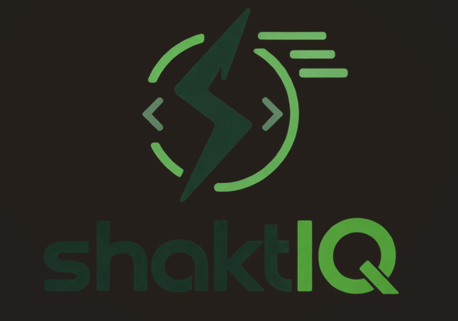
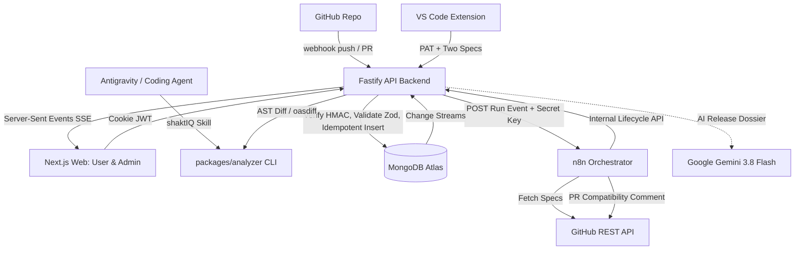

# shaktIQ ⚡

<p align="center">
  
</p>

<p align="center">
  <strong>Deterministic OpenAPI Breaking Change Detection, Release Compatibility Gating & Historical Hotspot Intelligence</strong>
</p>

<p align="center">
  <a href="https://marketplace.visualstudio.com/items?itemName=shaktIQ.shaktiq-vscode"></a>
  <a href="https://shaktiq.vercel.app"></a>
  <a href="https://uncharted-shakti-1.onrender.com/api/v1/health"></a>
  <a href="https://www.mongodb.com/atlas"></a>
  <a href="https://nodejs.org/"></a>
  <a href="LICENSE"></a>
</p>

---

## 📑 Table of Contents

- [⚡ Quick Start: 5 Ways to Use shaktIQ](#-quick-start-5-ways-to-use-shaktiq)
  - [1. Web Dashboard (Zero Install)](#1-web-dashboard-zero-install)
  - [2. Visual Studio Code Extension](#2-visual-studio-code-extension)
  - [3. Google Antigravity (AI Coding Agent Skill)](#3-google-antigravity-ai-coding-agent-skill)
  - [4. Cursor / Windsurf / Claude Code (MCP)](#4-cursor--windsurf--claude-code-mcp)
  - [5. CLI (Command Line & Terminal)](#5-cli-command-line--terminal)
  - [6. CI/CD & GitHub Actions (Automated PR Gate)](#6-cicd--github-actions-automated-pr-gate)
- [📌 The Problem shaktIQ Solves](#-the-problem-shaktiq-solves)
- [🚦 Understanding Release Safety Verdicts](#-understanding-release-safety-verdicts)
- [🌟 Key Features](#-key-features)
- [🏗️ System Architecture](#️-system-architecture)
- [🍃 Production MongoDB Atlas Deep Dive](#-production-mongodb-atlas-deep-dive)
- [🚀 Step-by-Step Local Development & Self-Hosting](#-step-by-step-local-development--self-hosting)
- [📁 Monorepo Workspace Structure](#-monorepo-workspace-structure)
- [🔒 Security & Threat Modeling](#-security--threat-modeling)
- [🧪 Testing & Quality Assurance](#-testing--quality-assurance)
- [👥 Team & Hackathon Ownership](#-team--hackathon-ownership)
- [📖 System Documentation](#-system-documentation)
- [⚖️ License](#️-license)

---

## ⚡ Quick Start: 5 Ways to Use shaktIQ

Choose the environment where you work. You can be up and running in **under 2 minutes**:

```
                       ┌──────────────────────────────────────┐
                       │             shaktIQ Hub              │
                       └──────────────────┬───────────────────┘
                                          │
         ┌───────────────┬────────────────┼───────────────┬───────────────┐
         ▼               ▼                ▼               ▼               ▼
   🌐 Web Console   💻 VS Code Ext   🤖 Antigravity  🖥️ Terminal/CLI  🚀 GitHub Actions
  (Instant Trial)  (In-Editor Lint) (AI Agent Skill) (DevOps/Scripts)  (PR Block Gate)
```

---

### 1. Web Dashboard (Zero Install)

The fastest way to experience shaktIQ without installing any software or extensions:

1. Open the live console at **[https://shaktiq.vercel.app](https://shaktiq.vercel.app)**.
2. Sign in or register a new user in 10 seconds.
3. Select an existing project or run an interactive spec comparison.
4. Inspect the **Blast Radius Matrix** across Mobile (iOS/Android), Web SPAs, and Backend Microservices.
5. Click **AI Release Dossier** to interact with the **shaktIQ Gemini 3.8 AI Assistant** for instant non-breaking patch code!

---

### 2. Visual Studio Code Extension

Catch breaking API changes in real-time as you type, right inside your editor:

1. **Install from Marketplace:**
   - In VS Code, press `Ctrl+Shift+X` (or `Cmd+Shift+X` on macOS).
   - Search for **`shaktIQ`**.
   - Click **Install** (or install directly from the [VS Code Marketplace](https://marketplace.visualstudio.com/items?itemName=shaktIQ.shaktiq-vscode)).
2. **Analyze an OpenAPI File:**
   - Open any workspace containing an `openapi.yaml`, `openapi.json`, or `swagger.json` file.
   - Press `Ctrl+Shift+P` ➔ run **`shaktIQ: Analyze API changes`**.
3. **Inspect Diagnostics:**
   - Breaking changes are highlighted directly in your code with red squiggly error diagnostics.
   - Hover over any flagged line to see the rule violation, client blast radius, and remediation advice.
   - Open the **Problems** tab (`Ctrl+Shift+M`) for a complete grouped checklist of all API issues.
4. *(Optional)* **Connect to Your Team Backend:**
   - Open VS Code Settings (`Ctrl+,`) and search for `shaktiq`.
   - Set `shaktiq.apiUrl` to your live API (default: `https://uncharted-shakti-1.onrender.com/api/v1`).
   - Paste your Personal Access Token (`shaktiq.apiToken`) generated from your Web Dashboard profile.

---

### 3. Google Antigravity (AI Coding Agent Skill)

Equip your AI coding agent with the `shaktIQ` skill so it automatically verifies API contracts and catches breaking changes **in-between code writing and controller refactoring**:

#### Option A: In Your Current Project (Recommended)
Run this single command inside your project root:

```bash
# macOS / Linux / Git Bash:
mkdir -p .agents/skills/shaktiq
curl -sSL https://raw.githubusercontent.com/subratoghosh/uncharted_shakti_1/main/.agents/skills/shaktiq/SKILL.md -o .agents/skills/shaktiq/SKILL.md

# Windows PowerShell:
New-Item -ItemType Directory -Force .agents\skills\shaktiq
Invoke-WebRequest -Uri "https://raw.githubusercontent.com/subratoghosh/uncharted_shakti_1/main/.agents/skills/shaktiq/SKILL.md" -OutFile ".agents\skills\shaktiq\SKILL.md"
```

#### Option B: Globally Across All Projects
Make `shaktIQ` available to Antigravity across all your workspaces:

- **Windows PowerShell:**
  ```powershell
  New-Item -ItemType Directory -Force "$env:USERPROFILE\.gemini\config\skills\shaktiq"
  Invoke-WebRequest -Uri "https://raw.githubusercontent.com/subratoghosh/uncharted_shakti_1/main/.agents/skills/shaktiq/SKILL.md" -OutFile "$env:USERPROFILE\.gemini\config\skills\shaktiq\SKILL.md"
  ```
- **macOS / Linux:**
  ```bash
  mkdir -p ~/.gemini/config/skills/shaktiq
  curl -sSL https://raw.githubusercontent.com/subratoghosh/uncharted_shakti_1/main/.agents/skills/shaktiq/SKILL.md -o ~/.gemini/config/skills/shaktiq/SKILL.md
  ```

#### How to Use It in Agent Chat:
Whenever you or your agent edits routes, controllers, or schemas, prompt your agent:
> *"Run shaktIQ to check if my changes to the users API introduce any breaking changes against main."*

The agent will execute the in-flight check, review the deterministic findings, and automatically apply non-breaking AST remedies.

---

### 4. Cursor / Windsurf / Claude Code (MCP)

Connect `shaktIQ` as a standard **Model Context Protocol (MCP)** tool server:

Add the following to your agent configuration (`mcp_config.json` or Cursor Settings ➔ Features ➔ MCP):

```json
{
  "mcpServers": {
    "shaktiq": {
      "command": "node",
      "args": ["packages/analyzer/dist/mcp.js"]
    }
  }
}
```

Exposed native tools:
- `shaktiq_analyze({ base_spec, head_spec })`: Analyzes two OpenAPI files directly.
- `shaktiq_git_diff({ spec_path, base_ref })`: Compares your working spec against git `HEAD` or any branch.

---

### 5. CLI (Command Line & Terminal)

Run deterministic OpenAPI checks directly from your terminal or shell scripts:

```bash
# 1. Compare your current working spec against git main branch:
npm run shaktiq -- git-diff --spec ./openapi.yaml --base-ref main --markdown

# 2. Compare two OpenAPI specification files directly:
npm run shaktiq -- analyze --base fixtures/openapi/v1-base.yaml --head fixtures/openapi/v2-breaking.yaml --markdown

# 3. Output machine-readable JSON (ideal for custom scripts and agents):
npm run shaktiq -- analyze --base ./base.yaml --head ./head.yaml --json

# 4. Strict CI gate (exits with code 1 if any breaking change is detected):
npm run shaktiq -- analyze --base ./base.yaml --head ./head.yaml --fail-on-breaking
```

---

### 6. CI/CD & GitHub Actions (Automated PR Gate)

Prevent breaking API changes from ever merging into your production branch by adding an automated compatibility gate.

Create `.github/workflows/shaktiq.yml` in your repository:

```yaml
name: shaktIQ API Release Gate

on:
  pull_request:
    paths:
      - '**/openapi.yaml'
      - '**/openapi.json'
      - '**/swagger.json'

jobs:
  verify-api-compatibility:
    name: Verify Backward Compatibility
    runs-on: ubuntu-latest
    steps:
      - name: Checkout Code
        uses: actions/checkout@v4
        with:
          fetch-depth: 0 # Full git history required for branch diffing

      - name: Setup Node.js 20
        uses: actions/setup-node@v4
        with:
          node-version: 20
          cache: 'npm'

      - name: Install Dependencies
        run: npm ci

      - name: Run shaktIQ Compatibility Check
        run: |
          node packages/analyzer/dist/cli.js git-diff \
            --spec ./openapi.yaml \
            --base-ref origin/main \
            --fail-on-breaking \
            --markdown >> $GITHUB_STEP_SUMMARY
```

If a pull request deletes an endpoint or changes a parameter type, the CI workflow will exit with code `1`, blocking the merge and printing a clear markdown table directly into the GitHub Actions Step Summary!

---

## 📌 The Problem shaktIQ Solves

API teams update OpenAPI specifications constantly. Removing an endpoint, adding a required request parameter, or changing a field type silently breaks mobile applications, partner integrations, and internal microservices.

- **Human Code Review Fails:** Engineers cannot reliably diff 3,000-line YAML files during busy pull request reviews.
- **LLM Diffing Is Unreliable:** LLM-based diffing is non-deterministic, hallucinates breaking rules, and cannot be trusted as a hard CI gate.
- **Teams Suffer from Amnesia:** Nobody remembers that an endpoint like `/orders/{id}` has broken downstream consumers three times across the last four sprints.

### The Question shaktIQ Answers:
> *"Will our latest API changes break existing consumers, which clients will be affected, and how do we fix it before deploying?"*

shaktIQ answers this deterministically before changes hit production, tracks project memory across releases, and delivers verdicts where developers already work: **GitHub PRs**, **VS Code**, **AI Coding Agents**, and a **Web Dashboard**.

---

## 🚦 Understanding Release Safety Verdicts

Every shaktIQ run evaluates ~300 OpenAPI 3.0/3.1 rules and computes an unambiguous release verdict:

| Verdict | Indicator | Meaning | CI Exit Code | Recommended Action |
|:---|:---:|:---|:---:|:---|
| **`SAFE`** | 🟢 | Only additive or backward-compatible changes detected (e.g. new optional parameters, new endpoints, new non-breaking response fields). | `0` | Safe to merge and deploy immediately. |
| **`REVIEW`** | 🟡 | Contract warnings detected that do not immediately crash consumers but require engineering attention (e.g. endpoint deprecation, altered descriptions). | `0` | Review with team before release. |
| **`BLOCKED`** | 🔴 | One or more breaking changes detected (e.g. removed paths, changed data types, new required fields, removed enum values). | `1` | **Block merge/release.** Apply non-breaking remediation recipes. |

---

## 🌟 Key Features

- 🎯 **Deterministic Breaking Change Detection:** Powered by `oasdiff` via `@shaktiq/analyzer` with an in-process pure-JS fallback for 100% zero-dependency uptime. Evaluates rules against OpenAPI 3.0 and 3.1 specs with zero hallucination.
- 🤖 **Google Gemini 3.8 Flash AI Intelligence:** Synthesizes AST code fix snippets, blast radius risk assessments for mobile/web/microservice clients, and comprehensive Release Dossiers.
- 💬 **Natural Language Project Assistant:** Ask shaktIQ questions in plain English (*"Will this release break our mobile app?"*, *"How do I fix the parameter mismatch on POST /orders?"*) with instant answers grounded in MongoDB release memory.
- 🛡️ **Three Developer Gateways:**
  - **Gateway 1: GitHub Pre-Release Gate:** Webhook triggers on `push` / `pull_request`, classifies risk, and posts automated compatibility comments.
  - **Gateway 2: VS Code Extension:** Developers compare their local working spec against `git HEAD` in real-time with diagnostics in the Problems panel.
  - **Gateway 3: Coding Agent Skill & Web Console:** Interactive Next.js console with run comparisons, endpoint hotspot tracking, and an AI chat assistant.
- 📊 **Historical Hotspot Intelligence:** Uses MongoDB aggregation pipelines to track endpoints that break repeatedly across releases, alerting teams to fragile API surfaces.

---

## 🏗️ System Architecture



---

## 🍃 Production MongoDB Atlas Deep Dive

shaktIQ is built with production-grade MongoDB Atlas architecture:

### 1. Strict Schema Validation (`$jsonSchema`)
All collections (`users`, `apiTokens`, `projects`, `events`, `runs`, `findings`, `specSnapshots`, `notifications`) are strictly validated at the database level with `validationLevel: "strict"` and `validationAction: "error"`:
- Rejects unexpected field structures or invalid enum values.
- Applied automatically via idempotent migration scripts (`apps/api/src/db/migrate.ts`).

### 2. High-Performance Aggregation Pipelines
- **Run-to-Run Diff (Compare Pipeline):** Categorizes findings between any base and head run into `new`, `resolved`, and `unresolved` using stable SHA-256 finding fingerprints.
- **Project Memory (Endpoint Hotspots):** Aggregates findings by `(method, endpoint)` across completed runs to highlight endpoints with recurring breaks (`distinctRuns >= 2`).
- **Release Verdict Summary:** Evaluates release readiness into honest status states (`safe`, `review`, `blocked`).
- **Admin System Telemetry:** Single `$facet` aggregation summarizing run statuses, duplicate delivery counts, and rejected signatures over 24-hour windows.

### 3. Change Streams + Server-Sent Events (SSE)
- Listens to native Change Streams on `runs` and `events`.
- Emits real-time SSE events (`run.updated`, `event.received`, `event.duplicate`) to connected dashboard clients.
- Scoped strictly to user authorization and project boundaries.

### 4. Zero-Duplicate Idempotent Ingestion
- `events` collection enforces a unique index on `eventId` (`github:<delivery_uuid>`).
- On duplicate delivery (MongoDB error code `11000`), atomically increments `duplicateCount` and returns the existing `runId` without dispatching duplicate workloads.
- Secondary unique index on `runs.eventId` prevents race conditions.
- Findings enforce `{ runId: 1, fingerprint: 1 }` unique constraint, making analysis retries idempotent.

### 5. Automated Data Lifecycle (TTL Indexes)
- `events.receivedAt`: 30-day TTL index automatically purges raw event logs.
- `notifications.createdAt`: 90-day TTL index cleans delivery history.
- `specSnapshots`: De-duplicated by `(projectId, sha256)` hash to store identical spec files only once.

---

## 🚀 Step-by-Step Local Development & Self-Hosting

Follow these simple steps to run the complete shaktIQ stack locally on your machine:

### Prerequisites
- **Node.js:** `^20.0.0` (LTS recommended)
- **npm:** `^10.0.0`
- **Git**
- **MongoDB Atlas** Free Tier M0 (or local MongoDB replica set with change streams enabled)

### Step 1: Clone the Repository
```bash
git clone https://github.com/subratoghosh/uncharted_shakti_1.git shaktiq
cd shaktiq
```

### Step 2: Install Dependencies
```bash
npm install
```

### Step 3: Configure Environment Variables
Copy `.env.example` to `.env` in the root and in `apps/api`:
```bash
# In project root:
cp .env.example .env

# In API directory:
cp infra/.env.example apps/api/.env
```

Ensure the following variables are filled in your `.env`:
```ini
NODE_ENV=development
PORT=4000
MONGODB_URI=mongodb+srv://<username>:<password>@cluster.mongodb.net/shaktiq?retryWrites=true&w=majority
MONGODB_DB=shaktiq
JWT_SECRET=super_secret_jwt_key_at_least_32_chars_long
INTERNAL_API_KEY=super_secret_internal_key_at_least_32_chars_long
GITHUB_WEBHOOK_SECRET=your_github_webhook_secret
WEB_ORIGIN=http://localhost:3000
GEMINI_API_KEY=your_gemini_api_key_here
```

### Step 4: Run Database Migrations
Initialize all strict `$jsonSchema` validators and production indexes in MongoDB:
```bash
npm run db:migrate -w apps/api
```

### Step 5: Start Backend & Frontend
Run both services in separate terminals (or concurrently):

```bash
# Terminal 1: Backend Fastify API (Runs on port 4000)
npm run dev -w apps/api

# Terminal 2: Web Dashboard (Runs on port 3000)
npm run dev -w apps/web
```

Visit **`http://localhost:3000`** in your browser!

### Step 6: (Optional) Test the VS Code Extension Locally
1. Open the `apps/vscode-ext` folder in VS Code.
2. Press `F5` to launch an Extension Development Host window.
3. Open any folder with an OpenAPI spec and run `Ctrl+Shift+P` ➔ **`shaktIQ: Analyze API changes`**.

---

## 📁 Monorepo Workspace Structure

```
shaktiq/
├── apps/
│   ├── api/            # Fastify backend (Auth, Ingestion, MongoDB, SSE, Gemini)
│   ├── web/            # Next.js App Router (Dashboard, AI Dossier, shadcn/ui)
│   └── vscode-ext/     # VS Code Extension (Publisher: shaktIQ)
├── packages/
│   ├── shared/         # Zod schemas, types, DTOs, ROUTES, error codes
│   └── analyzer/       # Deterministic AST diff engine, rule mappings & CLI/MCP
├── .agents/
│   └── skills/         # AI coding agent skills (Antigravity skill: shaktiq)
├── scripts/
│   ├── install-agent-skill.sh   # Bash installer for Linux/macOS
│   └── install-agent-skill.ps1  # PowerShell installer for Windows
├── fixtures/openapi/   # Versioned OpenAPI 3.0/3.1 test fixtures
├── infra/              # Docker Compose, Dockerfiles, .env.example
└── docs/               # Full system documentation & specifications
```

---

## 🔒 Security & Threat Modeling

- **Zero Untrusted Execution:** shaktIQ parses OpenAPI specs purely as structured text; user repository code is never executed.
- **HMAC-SHA256 Signature Verification:** GitHub webhooks are verified with raw byte buffering and `crypto.timingSafeEqual`. Invalid signatures are rejected immediately (HTTP 401) and logged.
- **Authentication:**
  - **Web Dashboard:** Argon2id password hashing + HTTP-only, `SameSite=Lax`, secure JWT cookies.
  - **VS Code Extension:** Personal Access Tokens (`sq_...`) stored strictly as SHA-256 hashes.
- **Network Isolation:** Internal lifecycle routes (`/api/v1/internal/*`) require a 32+ character `INTERNAL_API_KEY`.
- **AI Safety & Privacy:** Gemini receives strictly structured finding metadata (method, endpoint, changeType). Raw user proprietary code is never forwarded to external LLMs.

---

## 🧪 Testing & Quality Assurance

shaktIQ maintains high code quality with automated test suites:

```bash
# Typecheck all workspaces
npm run typecheck

# Lint codebase
npm run lint

# Run unit & integration test suite (Vitest)
npm test

# Run End-to-End browser tests (Playwright)
npm run e2e
```

---

## 👥 Team & Hackathon Ownership

Built with ❤️ for the **MongoDB Student Hackathon**:

| Member | Focus Area | Owned Codebases |
|---|---|---|
| **Subrato Ghosh** | Backend, Database, Security & Agent Skills | `apps/api`, `packages/shared`, `.agents/skills`, `docs/database.md`, `docs/security.md` |
| **Lavanya** | Frontend, AI Release Dossier & UI/UX | `apps/web`, `docs/design_system.md` |
| **Vicky** | Analyzer Engine, VS Code Extension & QA | `packages/analyzer`, `apps/vscode-ext`, `n8n/`, `fixtures/`, `docs/testing.md` |

---

## 📖 System Documentation

Detailed technical guides are available in the [`docs/`](docs/) directory:
- 📄 [Product Requirements Document (`docs/prd.md`)](docs/prd.md)
- 🏛️ [System Architecture & Lifecycle (`docs/architecture.md`)](docs/architecture.md)
- 💾 [MongoDB Schema, Indexes & Aggregations (`docs/database.md`)](docs/database.md)
- 🛡️ [Security, Threat Models & Redaction (`docs/security.md`)](docs/security.md)
- 🧪 [Testing Strategy & Acceptance Criteria (`docs/testing.md`)](docs/testing.md)
- 🎨 [Design System & UI Tokens (`docs/design_system.md`)](docs/design_system.md)
- 📐 [Code Style & Response Envelopes (`docs/code_style.md`)](docs/code_style.md)
- 🤝 [Team Responsibilities & Workspaces (`docs/agents.md`)](docs/agents.md)

---

## ⚖️ License

Distributed under the MIT License. See [`LICENSE`](LICENSE) for more information.