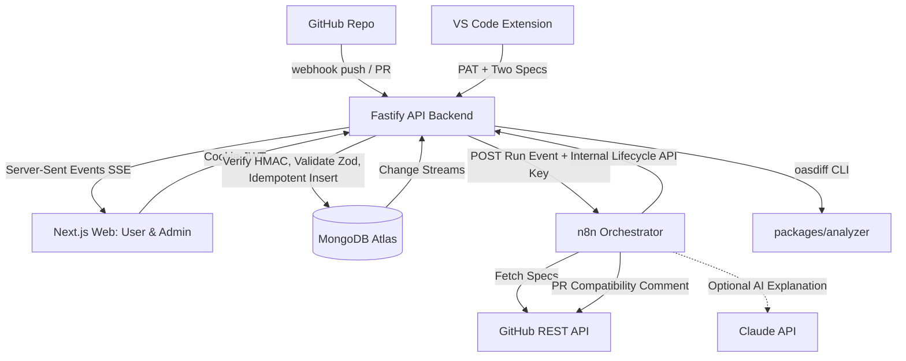
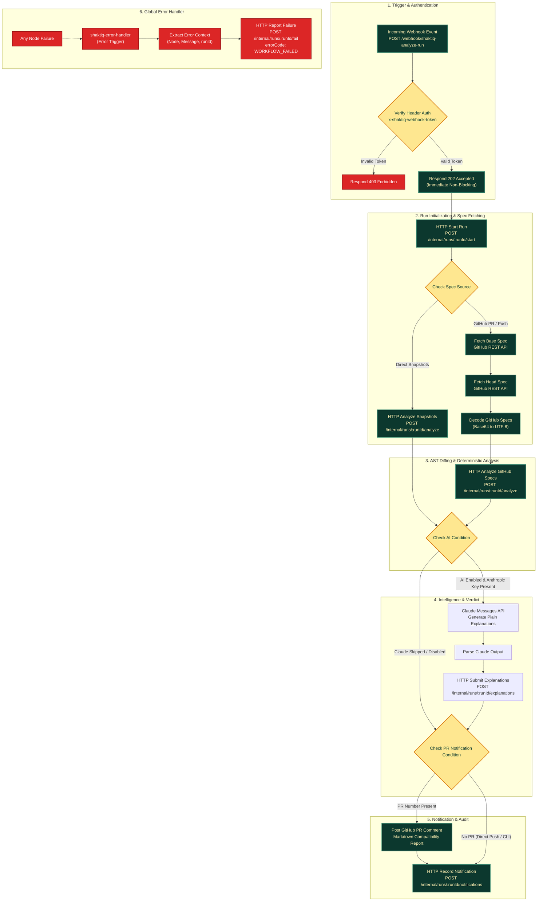

# ShaktIQ ⚡

> **Deterministic OpenAPI Breaking Change Detection, Release Compatibility Gating & Historical Hotspot Intelligence**
>
> *Built for the MongoDB Student Hackathon – Track 3: Developer Tools for Production Use Cases.*

[](https://nodejs.org/)
[](https://www.typescriptlang.org/)
[](https://www.mongodb.com/atlas)
[](https://www.fastify.io/)
[](https://nextjs.org/)
[](https://n8n.io/)
[](LICENSE)

---

## 📌 The Problem

API providers change OpenAPI specifications constantly. Removing an endpoint, adding a required request parameter, or changing a field type silently breaks mobile applications, partner integrations, and internal microservices.

- Reviewers rarely diff complex YAML line-by-line during code reviews.
- LLM-based diffing is non-deterministic, hallucinates breaking rules, and cannot be trusted as a hard CI gate.
- Teams suffer from amnesia: nobody remembers that an endpoint like `/orders/{id}` has already broken downstream consumers three times across recent releases.

### The Question ShaktIQ Solves
> *"Will the latest API changes break existing consumers, and what could be affected?"*

ShaktIQ answers this deterministically before changes hit production, tracks project memory across releases, and delivers verdicts where developers already work: **GitHub PRs**, **VS Code**, and a **Web Dashboard**.

---

## 🌟 Key Features

- 🎯 **Deterministic Breaking Change Detection:** Powered by `oasdiff` via `@shaktiq/analyzer`. Evaluates ~300 rules against OpenAPI 3.0/3.1 specs with zero hallucination.
- 🛡️ **Three Surfaces, One Unified Pipeline:**
  - **GitHub Pre-Release Gate:** Webhook triggers on `push` / `pull_request`, classifies risk, and posts automated compatibility comments.
  - **VS Code Extension:** Developers compare their local working spec against `git HEAD` in real-time with diagnostics in the Problems panel.
  - **User & Admin Web Dashboard:** Interactive Next.js console with run comparisons, endpoint hotspot tracking, and an admin audit trail.
- 🧠 **Project Memory & Endpoint Hotspots:** Identifies chronic risk areas by aggregating breaking changes across releases (`distinctRuns >= 2`).
- ⚡ **Real-Time Live Updates:** MongoDB Change Streams push real-time status transitions (`queued` → `running` → `completed`) over Server-Sent Events (SSE).
- 🔒 **Zero-Duplicate Idempotent Webhook Intake:** Guaranteed single execution under webhook delivery retries and races via MongoDB unique indexes and atomic updates.
- 🤖 **Optional Isolated AI Explanations:** Claude API (orchestrated via n8n) translates technical diffs into plain-language consumer impact and migration guides without compromising security.

---

## 🏗️ System Architecture



### Separation of Concerns: Backend vs. n8n

| Concern | Fastify Backend (`apps/api`) | n8n Orchestrator (`n8n/`) |
|---|:---:|:---:|
| Webhook HMAC Verification & Zod Validation | ✅ | ❌ |
| Auth (Argon2id, JWT, PAT) & Role Guardrails | ✅ | ❌ |
| Idempotent Event Intake & Run Creation | ✅ | ❌ |
| Core Diffing (`oasdiff`), Fingerprints & Rules | ✅ (`packages/analyzer`) | ❌ |
| MongoDB Aggregations, Memory & Release Reports | ✅ | ❌ |
| Change Streams & SSE Hub | ✅ | ❌ |
| Direct MongoDB Access | ✅ (Official Driver) | ❌ (Strictly forbidden) |
| Fetching Specs & Branch Artifacts from GitHub | ❌ | ✅ |
| External Step Retries (3x backoff) & Branching | ❌ | ✅ |
| GitHub PR Commenting & Notifications | ❌ | ✅ |
| Failure Recovery (`shaktiq-error-handler`) | ❌ (Receives fail report) | ✅ |

---

## ⚡ n8n Orchestration Workflows

ShaktIQ uses **n8n** as an asynchronous event-driven orchestrator between the Fastify API, GitHub repositories, and downstream consumer notifications. All workflows are defined as version-controlled JSON files in [`n8n/workflows/`](n8n/workflows/).

### Complete Workflow Pipeline Diagram



### Detailed Node Specifications

1. **`Webhook Trigger` & `Verify Header Auth`:**
   - Listens on `POST /webhook/shaktiq-analyze-run`.
   - Validates `x-shaktiq-webhook-token` against environment configuration. Rejects unauthorized traffic immediately with `403 Forbidden`.
   - Returns an immediate `202 Accepted` envelope so calling services are never blocked waiting for analysis.
2. **`HTTP Start Run`:**
   - Calls `POST /api/v1/internal/runs/:runId/start` authenticated by `x-shaktiq-internal-key`.
   - Transitions run state in MongoDB from `queued` to `running`, triggering real-time UI status updates via Change Streams and SSE.
3. **Spec Fetching (`Fetch Base Spec GitHub` & `Fetch Head Spec GitHub`):**
   - Automatically retrieves specification content from GitHub's Contents API using the repository path and commit refs with `Bearer {{ $env.GITHUB_TOKEN }}`.
   - Built-in 3x retry with 2000ms exponential backoff for network resilience.
4. **`HTTP Analyze Specs`:**
   - Dispatches specs to the core AST analyzer engine at `POST /api/v1/internal/runs/:runId/analyze`.
   - Executes deterministic AST diffing (`oasdiff`), generates SHA-256 finding fingerprints, and calculates the release verdict (`safe`, `review`, or `blocked`).
5. **`Check AI Condition` & Explanations:**
   - Evaluates whether AI explanations are requested and an Anthropic key is present. If skipped, continues automatically without blocking.
6. **`Post GitHub PR Comment`:**
   - Posts a rich markdown compatibility report directly to the pull request conversation on GitHub.
7. **`shaktiq-error-handler` (Error Recovery):**
   - Attached as the designated `errorWorkflow`. On any failure, captures the failing node and message, reporting the failure to `POST /internal/runs/:runId/fail` with `errorCode: WORKFLOW_FAILED` to guarantee clean state reconciliation.


---

## 🍃 Deep Dive: Production MongoDB Atlas Usage

ShaktIQ showcases production-grade MongoDB features tailored for developer tooling:

### 1. Strict Schema Validation (`$jsonSchema`)
All collections (`users`, `apiTokens`, `projects`, `events`, `runs`, `findings`, `specSnapshots`, `notifications`) are strictly validated at the database level with `validationLevel: "strict"` and `validationAction: "error"`:
- Rejects unexpected field structures or invalid enum values (e.g. unknown severities or event types).
- Applied automatically via idempotent migration scripts (`apps/api/src/db/migrate.ts`).

### 2. High-Performance Aggregation Pipelines
- **Run-to-Run Diff (Compare Pipeline):** Categorizes findings between any base and head run into `new`, `resolved`, and `unresolved` using stable SHA-256 finding fingerprints.
- **Project Memory (Endpoint Hotspots):** Aggregates findings by `(method, endpoint)` across completed runs to highlight endpoints with recurring breaks (`distinctRuns >= 2`).
- **Release Verdict Summary:** Evaluates release readiness into honest status states:
  - `safe`: No breaking or warning changes.
  - `review`: Warnings detected (requires human confirmation).
  - `blocked`: One or more breaking changes detected.
- **Admin System Telemetry:** Single `$facet` aggregation summarizing run statuses, duplicate delivery counts, and rejected signatures over 24-hour windows.

### 3. Change Streams + Server-Sent Events (SSE)
- Listens to native Change Streams on `runs` and `events`.
- Emits real-time SSE events (`run.updated`, `event.received`, `event.duplicate`) to connected dashboard clients.
- Scoped to user authorization and project boundaries.

### 4. Zero-Duplicate Idempotent Ingestion
- `events` collection enforces a unique index on `eventId` (`github:<delivery_uuid>`).
- On duplicate delivery (MongoDB error code `11000`), atomically increments `duplicateCount` and returns the existing `runId` without dispatching duplicate workloads.
- Secondary unique index on `runs.eventId` prevents race conditions.
- Findings enforce `{ runId: 1, fingerprint: 1 }` unique constraint, making analysis retries idempotent.

### 5. Automated Data Lifecycle (TTL Indexes)
- `events.receivedAt`: 30-day TTL index automatically purges raw event logs.
- `notifications.createdAt`: 90-day TTL index cleans delivery history.
- `specSnapshots`: De-duplicated by `(projectId, sha256)` hash to store identical spec files only once.

---

## 📁 Monorepo Workspace Structure

```
shaktiq/
├── apps/
│   ├── api/            # Fastify backend (Auth, Ingestion, MongoDB, SSE)
│   ├── web/            # Next.js App Router (User & Admin Portals, shadcn/ui)
│   └── vscode-ext/     # VS Code Extension (Local pre-commit analysis)
├── packages/
│   ├── shared/         # Zod schemas, types, DTOs, ROUTES, error codes
│   └── analyzer/       # oasdiff Go CLI wrapper, rule mappings & templates
├── n8n/
│   ├── workflows/      # Exported workflows (shaktiq-analyze-run, shaktiq-error-handler)
│   └── stub-api/       # Local development stub for internal endpoints
├── fixtures/openapi/   # Versioned OpenAPI 3.0/3.1 test fixtures
├── infra/              # Docker Compose, Dockerfiles, .env.example
└── docs/               # Full system documentation & specifications
    ├── prd.md          # Product Requirements Document
    ├── architecture.md # Monorepo & System Architecture
    ├── database.md     # MongoDB Schema, Indexes & Aggregations
    ├── security.md     # Zero Trust Security & Threat Modeling
    ├── testing.md      # Testing Pyramid & Fixtures Suite
    ├── design_system.md# UI Philosophy, Design Tokens & Rules
    ├── code_style.md   # TypeScript & Repository Conventions
    └── agents.md       # Team Roles, Workspaces & Contracts
```

---

## 🔒 Security & Threat Modeling

- **Zero Untrusted Execution:** ShaktIQ parses OpenAPI specs purely as structured text using `oasdiff`; repository code is never executed.
- **HMAC-SHA256 Signature Verification:** GitHub webhooks are verified with raw byte buffering and `crypto.timingSafeEqual`. Invalid signatures are rejected immediately (HTTP 401) and logged.
- **Authentication:**
  - **Web Dashboard:** Argon2id password hashing + HTTP-only, `SameSite=Lax`, secure JWT cookies.
  - **VS Code Extension:** Personal Access Tokens (`sq_...`) stored strictly as SHA-256 hashes.
- **Network Isolation:** Internal lifecycle routes (`/api/v1/internal/*`) require a 32+ character `INTERNAL_API_KEY` and are isolated to internal container networks.
- **AI Injection Mitigation:** Claude API receives strictly structured finding metadata (method, endpoint, changeType). Raw user specifications are never forwarded to the LLM.

---

## 👥 Team & Ownership

This project was built for the **MongoDB Student Hackathon** with clean monorepo ownership boundaries:

| Member | Focus Area | Owned Codebases |
|---|---|---|
| **Subrato Ghosh** | Backend, Database & Security | `apps/api`, `packages/shared`, `docs/database.md`, `docs/security.md` |
| **Lavanya** | Frontend & UI/UX | `apps/web`, `docs/design_system.md` |
| **Vicky** | Automation, Analyzer, VS Code & QA | `packages/analyzer`, `apps/vscode-ext`, `n8n/`, `fixtures/`, `infra/`, `docs/testing.md` |

---

## 🚀 Quick Start (Local Development)

### Prerequisites
- **Node.js:** `^20.0.0`
- **npm:** `^10.0.0`
- **Docker & Docker Compose** (for n8n and API containerization)
- **MongoDB Atlas** cluster (M0 free tier or higher with replica sets enabled for change streams)
- **oasdiff:** [Installed locally](https://github.com/Tufin/oasdiff) or run via Docker (`tufin/oasdiff`)

### 1. Clone & Install Dependencies
```bash
git clone https://github.com/subratoghosh/uncharted_shakti_1.git shaktiq
cd shaktiq
npm install
```

### 2. Configure Environment Variables
Copy `.env.example` in `infra/` or relevant packages:
```bash
cp infra/.env.example apps/api/.env
```

Key environment configurations:
```ini
NODE_ENV=development
PORT=4000
MONGODB_URI=mongodb+srv://<user>:<password>@cluster.mongodb.net/shaktiq?retryWrites=true&w=majority
MONGODB_DB=shaktiq
JWT_SECRET=super_secret_jwt_key_at_least_32_chars_long
INTERNAL_API_KEY=super_secret_internal_key_at_least_32_chars_long
GITHUB_WEBHOOK_SECRET=your_github_webhook_secret
WEB_ORIGIN=http://localhost:3000
N8N_WEBHOOK_URL=http://localhost:5678/webhook/shaktiq-analyze-run
N8N_WEBHOOK_TOKEN=your_n8n_token
OASDIFF_MODE=binary
AI_EXPLANATIONS_ENABLED=false
```

### 3. Initialize MongoDB Schemas & Indexes
Run the idempotent database migration script to set up validators and indexes:
```bash
npm run db:migrate -w apps/api
```

### 4. Run the Stack
Run development services concurrently:
```bash
# Start backend API (Port 4000)
npm run dev -w apps/api

# Start Web Dashboard (Port 3000)
npm run dev -w apps/web

# Or launch containers via Docker Compose
docker compose -f infra/docker-compose.yml up
```

---

## 🤖 AI Agent Skill & Plugin (Antigravity, Claude Code, Cursor, Windsurf)

ShaktIQ can be installed directly into AI coding agents as an **Agent Skill, Plugin, and MCP Tool** (similar to `graphify` and `ponytail`). This allows agents to run deterministic API contract diffs **in-between code execution**, catching breaking changes before code is ever committed or deployed.

### What It Is Called
- **Antigravity / Agent Skill:** Defined by `skills/shaktiq/SKILL.md` and `.agents/skills/shaktiq/SKILL.md`. Injected into agent context via *Progressive Disclosure*.
- **Agent Plugin:** Bundled via `plugin.json` and `plugin.yaml` with commands, tools, and hooks.
- **Model Context Protocol (MCP) Server:** Standard JSON-RPC stdio tool provider (`shaktiq_analyze` and `shaktiq_git_diff`).

### Quick Installation (1-Command Setup)

Run the automated installer script:
```bash
./scripts/install-agent-skill.sh
```

This installs:
1. `shaktiq` CLI globally into `~/.local/bin/shaktiq`.
2. ShaktIQ Skill into Antigravity global customizations (`~/.gemini/config/skills/shaktiq/SKILL.md`).
3. ShaktIQ Workspace Skill into `.agents/skills/shaktiq/SKILL.md` (auto-detected by repository agents).

### How AI Agents Use It Between Code Execution

When pair programming or editing backend controllers / OpenAPI schemas, agents can execute:

```bash
# 1. Compare working copy against git main branch (structured JSON for agents)
shaktiq git-diff --spec openapi.yaml --base-ref main --json

# 2. Compare working copy against git main branch (markdown for PR comments / chat)
shaktiq git-diff --spec openapi.yaml --base-ref main --markdown

# 3. Direct comparison between two spec files:
shaktiq analyze --base ./base.yaml --head ./head.yaml --json

# 4. Strict CI / pre-commit mode (exits with code 1 on breaking changes):
shaktiq analyze --base ./base.yaml --head ./head.yaml --fail-on-breaking
```

### Model Context Protocol (MCP) Configuration

Add ShaktIQ to your agent's `mcp_config.json` (Antigravity, Claude Desktop, Cursor, Windsurf):

```json
{
  "mcpServers": {
    "shaktiq": {
      "command": "shaktiq-mcp"
    }
  }
}
```

Exposed native tools:
- `shaktiq_analyze({ base_spec, head_spec })`
- `shaktiq_git_diff({ spec_path, base_ref })`

---

## 🧪 Testing & Quality Assurance

ShaktIQ follows a rigorous testing pyramid:

```bash
# Typecheck all workspaces
npm run typecheck

# Lint codebase
npm run lint

# Run unit & integration test suite (Vitest)
npm test

# Run Playwright End-to-End tests
npm run e2e
```

### Test Suite Highlights
- **Deterministic Analyzer Tests:** Tested against 10 versioned fixtures in `fixtures/openapi/` validating endpoint removal, method deletion, parameter mutations, and type changes.
- **Race Condition & Idempotency Tests:** Verifies duplicate webhook delivery rejection under 20 concurrent requests.
- **MongoDB Aggregation Validation:** Tests run comparison (`new` / `resolved` / `unresolved`) and endpoint hotspot rankings.
- **Change Stream Reconnection:** Validates SSE emission and auto-recovery on connection drops.

---

## 📖 System Documentation

Detailed architectural and engineering documentation is available in the [`docs/`](docs/) directory:
- 📄 [Product Requirements Document (`docs/prd.md`)](docs/prd.md)
- 🏛️ [System Architecture & Lifecycle (`docs/architecture.md`)](docs/architecture.md)
- 💾 [MongoDB Schema, Indexes & Aggregations (`docs/database.md`)](docs/database.md)
- 🛡️ [Security, Threat Models & Redaction (`docs/security.md`)](docs/security.md)
- 🧪 [Testing Strategy & Acceptance Criteria (`docs/testing.md`)](docs/testing.md)
- 🎨 [Design System & UI Tokens (`docs/design_system.md`)](docs/design_system.md)
- 📐 [Code Style & Response Envelopes (`docs/code_style.md`)](docs/code_style.md)
- 🤝 [Team Responsibilities & Workspaces (`docs/agents.md`)](docs/agents.md)

---

## ⚖️ License

Distributed under the MIT License. See `LICENSE` for more information.