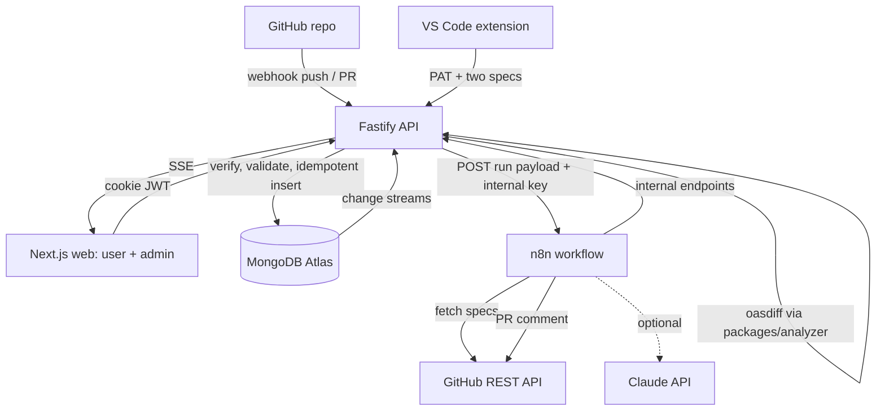
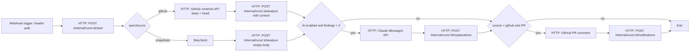
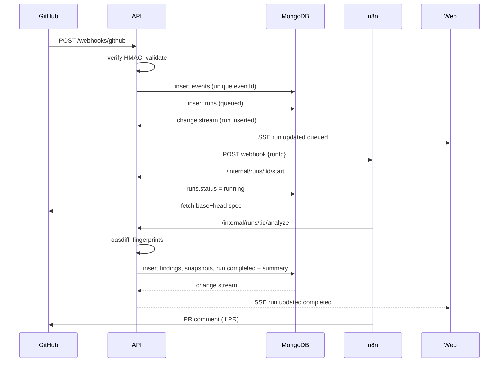
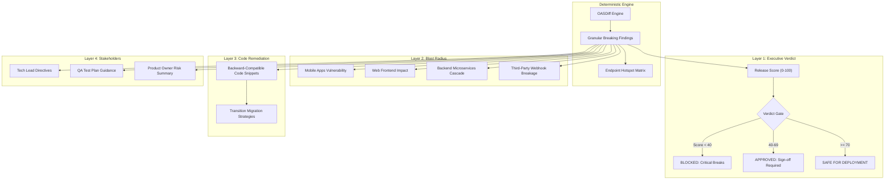

# ShaktIQ – Architecture

## 1. Monorepo Layout (npm workspaces)
```
shaktiq/
  apps/
    api/            Fastify backend                      (Suibrato)
    web/            Next.js: user panel + admin panel     (Lavanya)
    vscode-ext/     VS Code extension (thin client)       (Vicky)
  packages/
    shared/         Zod schemas, types, enums, route constants  (Suibrato, contract owner)
    analyzer/       oasdiff wrapper + rules + templates         (Vicky)
  n8n/
    workflows/      exported workflow JSON                (Vicky)
    stub-api/       local stub of /internal endpoints     (Vicky)
  fixtures/openapi/ versioned OpenAPI fixtures             (Vicky)
  infra/            docker-compose.yml, Dockerfiles, .env.example (Vicky)
  docs/             the eight planning docs
```

## 2. System Diagram


## 3. Responsibilities: Backend vs n8n
| Concern | Backend (Fastify) | n8n |
|---|---|---|
| Webhook signature, payload validation | ✅ | ❌ |
| Auth, roles, ownership checks | ✅ | ❌ |
| Idempotent event insert, run creation | ✅ | ❌ |
| Run status transitions, DB writes | ✅ | ❌ (only via internal API) |
| oasdiff execution, severity mapping, fingerprints, templates | ✅ (`packages/analyzer`) | ❌ |
| Aggregations, memory, reports | ✅ | ❌ |
| Change streams + SSE | ✅ | ❌ |
| Fetch base/head spec from GitHub | ❌ | ✅ |
| Orchestrate steps, retries, branching | ❌ | ✅ |
| Optional Claude call | ❌ | ✅ |
| PR comment / notification | ❌ (stores result) | ✅ |
| Failure handling (error workflow) | ❌ | ✅ (reports to backend) |

Rule: n8n never writes to MongoDB directly and never holds business rules. It only calls `/api/v1/internal/*`.

## 4. n8n Workflows
### 4.1 `shaktiq-analyze-run` (main)

HTTP nodes calling the backend: retry 3×, 2 s backoff. Respond to the webhook trigger immediately (202) so the backend never waits.

### 4.2 `shaktiq-error-handler`
Error Trigger → extracts `runId` from execution data → `POST /internal/runs/:id/fail` with `errorCode: WORKFLOW_FAILED` and message. Set as error workflow on the main workflow.

## 5. Backend Architecture (`apps/api`)
```
src/
  server.ts            build & start Fastify
  config/env.ts        Zod-validated env
  plugins/             auth, rateLimit, cors, mongo, sse, rawBody
  modules/
    auth/              routes, service
    projects/
    events/            webhook intake + idempotency
    runs/              lifecycle, compare, report
    findings/
    memory/
    admin/
    internal/          n8n-only routes
    cli/               VS Code analyze route
    stream/            change streams + SSE hub
  db/                  client, collections.ts, validators/, indexes.ts, migrate.ts
  lib/                 errors, response, logger, hash
```
Layers: route (validate with Zod from `packages/shared`) → service (business logic) → repository (Mongo calls). Routes never touch collections directly.

## 6. Intake and Idempotency
1. Read raw body (needed for HMAC). 2. Verify `X-Hub-Signature-256` with timing-safe compare. 3. Zod-validate the payload subset. 4. Resolve project by `repository.full_name`. 5. Build `eventId = "github:" + X-GitHub-Delivery`. 6. `insertOne` into `events` (unique index on `eventId`). On duplicate-key error (11000) → `$inc duplicateCount`, set `lastDuplicateAt`, return 200 `duplicate:true` with existing `runId`. 7. Create run (unique on `runs.eventId`, so even a race cannot create two). 8. POST to n8n; on failure mark run `failed` (`WORKFLOW_UNAVAILABLE`).
Manual/VS Code requests use `eventId = "manual:" + Idempotency-Key` (UUID from client; server generates if missing).

## 7. Change Streams and SSE
`stream/hub.ts` opens one change stream on `runs` (insert, update) and one on `events` (insert, update where `duplicateCount` changed). Each change is mapped to an SSE message and broadcast to subscribers filtered by `projectId` and user authorization (admin sees all). Endpoint: `GET /api/v1/stream?projectId=...`. Heartbeat comment every 25 s. On stream error: reopen with backoff; clients refetch on reconnect. Atlas M0 supports change streams.

## 8. API Endpoints (all under `/api/v1`, JSON, envelope in code_style.md)
**Auth:** `POST /auth/register`, `POST /auth/login`, `POST /auth/logout`, `GET /auth/me`, `GET|POST /tokens`, `DELETE /tokens/:tokenId`
**Projects:** `GET|POST /projects`, `GET|PATCH|DELETE /projects/:projectId`
**Runs:** `POST /projects/:projectId/runs` (manual), `GET /projects/:projectId/runs`, `GET /runs/:runId`, `GET /runs/:runId/findings`, `GET /runs/:runId/report`, `GET /projects/:projectId/compare?base=<runId>&head=<runId>`
**Memory:** `GET /projects/:projectId/memory/hotspots`, `GET /projects/:projectId/memory/endpoint?method=&path=`
**Webhook:** `POST /webhooks/github`
**VS Code:** `POST /cli/analyze` (PAT auth)
**Stream:** `GET /stream`
**Admin (role=admin):** `GET /admin/overview`, `GET /admin/projects`, `GET /admin/runs`, `GET /admin/events`, `GET /admin/workflows/health`, `POST /admin/runs/:runId/retry`, `GET /admin/users`, `PATCH /admin/users/:userId`
**Internal (header `x-shaktiq-internal-key`, n8n only):** `POST /internal/runs/:runId/start`, `POST /internal/runs/:runId/analyze`, `POST /internal/runs/:runId/explanations`, `POST /internal/runs/:runId/notifications`, `POST /internal/runs/:runId/fail`
**Health:** `GET /health`

## 9. Analysis Engine (`packages/analyzer`)
Public API (typed in `packages/shared`): `compareSpecs(baseSpec: string, headSpec: string): Promise<FindingDraft[]>`.
- Tool: **oasdiff** (Go CLI, handles $ref resolution, OpenAPI 3.0/3.1, ~300 breaking-change checks, JSON output). Installed in the API Docker image; invoked with `child_process.execFile` (never shell), specs written to a temp dir, 10 s timeout, temp dir removed afterwards.
- Command: `oasdiff changelog base.yaml head.yaml --format json`. Map `level` 3→`breaking`, 2→`warning`, 1→`info`. Rule-id → `changeType` table in `rules.ts`; unknown → `OTHER`.
- Fingerprint: `sha256(projectId | METHOD | path | changeType | oasdiffId | locationText)`; stable across runs so aggregation can diff runs.
- Impact/recommendation text: deterministic template per `changeType` in `templates.ts`.
- Fallback if oasdiff cannot be installed on a dev machine: use Docker image `tufin/oasdiff` through the same wrapper (config `OASDIFF_MODE=binary|docker`). Verify exact JSON field names against the installed version during Phase 2.

## 10. Spec Storage Decision
Specs are stored once in `specSnapshots` keyed by `(projectId, sha256)` (unique), max 5 MB. Findings and runs reference snapshot IDs/hashes, never embed the spec. GitHub-sourced specs also record `repo`, `path`, `commitSha`.

## 11. Sequence: GitHub Push


## 12. Error Handling
| Failure | Behavior |
|---|---|
| Invalid signature | 401 `INVALID_SIGNATURE`, logged, counted in admin Events as rejected (stored in `events` with `processingStatus: rejected`, unique-keyed by delivery ID prefix `rejected:`) |
| Malformed payload | 400 `VALIDATION_ERROR` |
| Duplicate | 200 `duplicate:true` |
| n8n unreachable | run `failed`, `WORKFLOW_UNAVAILABLE`, admin can retry |
| Spec fetch 404 | n8n error workflow → `fail` with `SPEC_NOT_FOUND` |
| Corrupt spec / oasdiff error | `analyze` marks run `failed`, `SPEC_INVALID` |
| Claude failure | ignored; run still completed (`aiStatus: "failed"`) |
| Change stream error | reconnect with backoff |

## 13. Deployment (local / demo)
`infra/docker-compose.yml`: `api` (Node 20 + oasdiff), `web` (Next.js), `n8n` (volume for data, basic auth, `N8N_ENCRYPTION_KEY`), and optional `ngrok`/`cloudflared` to expose the API webhook to GitHub. MongoDB is Atlas (not in compose). Ports: web 3000, api 4000, n8n 5678. Network: n8n reaches API at `http://api:4000`, API reaches n8n at `http://n8n:5678`.

## 14. Technology Decisions
- **Fastify** over Express: built-in schema/validation hooks, speed, good TS support, raw body plugin.
- **Official Mongo driver**: direct access to change streams, validators, aggregations; Mongoose adds nothing here.
- **oasdiff** over LLM or hand-rolled diff: deterministic, battle-tested.
- **SSE** over WebSocket: one-way updates, simpler, works with cookies.
- **n8n** as orchestrator only: demonstrates automation without moving core logic into low-code.
- **One pipeline, three entry points**: avoids divergent behavior.

---

## 10. Multi-Layer AI Release Intelligence Pipeline

ShaktIQ pairs deterministic OASDiff breaking-change detection with a multi-layer Google Gemini intelligence engine. Rather than outputting raw diffs, it synthesizes an executive release dossier across 4 distinct layers:



### Key Design Pillars:
1. **Zero Hallucination Grounding**: The AI model is strictly bounded by the deterministic findings list produced by OASDiff.
2. **Deterministic Fallback**: If `GEMINI_API_KEY` is absent or the cloud provider experiences an outage, ShaktIQ uses a zero-latency heuristic intelligence engine so CI/CD pipelines never block unexpectedly.
3. **Persisted Dossiers**: Synthesized dossiers are stored in MongoDB under `aiReleaseDossier` on the run document, preventing redundant LLM invocations and ensuring reproducibility.

